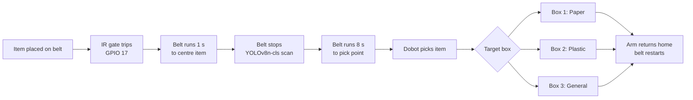

# EcoNexus — Robotic Waste-Sorting Line

A 1:20-scale automated waste-sorting line: a conveyor carries an item under a camera, a Raspberry Pi 4 classifies it on-device with YOLOv8, and a Dobot Magician arm picks it off the belt and drops it into a **Paper**, **Plastic** or **General** box. A small Flask page streams the live camera view with the line's status overlaid.

Built by a BEng (Hons) Robotics and Artificial Intelligence team (University of Hertfordshire, delivered at PSB Academy, Singapore) as the sorting cell of a smart waste management competition project.

> **Status:** the prototype was built and demonstrated, then dismantled. This repository holds the control script that ran the line. See [What this code does and does not do](#what-this-code-does-and-does-not-do) before relying on it.

---

## How the line works



One cycle, step by step:

1. The conveyor runs continuously at 25 mm/s.
2. An item breaks the IR beam; the belt runs one more second so the item sits under the camera.
3. The belt stops. The centre half of the frame is cropped and passed to YOLOv8n-cls.
4. The belt runs 8 seconds to carry the item to the arm's pick point, then stops.
5. The Dobot lowers, grips, lifts to a safe hover height, moves over the target box and releases.
6. The arm returns home and the belt restarts for the next item.

Three threads run side by side: a camera worker (capture + overlay + JPEG encode), the sorting logic, and the Flask server.

## Hardware

| Part | Detail |
|---|---|
| Compute | Raspberry Pi 4 |
| Camera | CSI Camera Module V2 in a fixed 3D-printed mount |
| Manipulator | Dobot Magician with gripper, USB serial (`/dev/ttyACM0`) |
| Conveyor | Stepper-driven belt on the Dobot's Stepper 1 port |
| Trigger | IR sensor on Raspberry Pi GPIO 17 |
| Classifier | YOLOv8n-cls (Ultralytics), CPU inference on the Pi |
| Supply | 12 V DC, no mains exposure |

## Setup

On Raspberry Pi OS (64-bit):

```bash
sudo apt update
sudo apt install -y python3-picamera2

git clone https://github.com/kris072008/econexus.git
cd econexus
python3 -m venv --system-site-packages .venv
source .venv/bin/activate
pip install -r requirements.txt
```

`--system-site-packages` lets the virtual environment see the apt-installed `picamera2`. The `yolov8n-cls.pt` weights download automatically on first run.

## Run

```bash
python3 sorting_line.py
```

Then open `http://<pi-ip-address>:8000` on any device on the same network to watch the live feed. Stop with `Ctrl+C`; the script stops the belt and releases the arm and camera on exit.

## Configuration

Everything is set by constants at the top of `sorting_line.py`. Arm coordinates are specific to our bench layout and **must be re-taught** for any other setup.

| Constant | Default | Meaning |
|---|---|---|
| `DOBOT_PORT` | `/dev/ttyACM0` | Serial port of the Dobot |
| `CONVEYOR_SPEED` | `25.0` | Belt speed in mm/s |
| `SETTLE_TIME_SEC` | `1.0` | Belt run time after the IR trigger, to centre the item under the camera |
| `TRAVEL_TIME_SEC` | `8.0` | Belt run time from the camera to the pick point |
| `HOME_POS`, `PICK_POS` | — | Arm home and belt pickup poses (X, Y, Z, R) |
| `BOX_PAPER`, `BOX_PLASTIC`, `BOX_GENERAL` | — | Drop poses for the three boxes |
| `HOVER_Z` | `110.0` | Safe travel height between moves |
| `TARGET_SEQUENCE` | Paper → Plastic → General | Demo routing order (see below) |

## What this code does and does not do

This script is the demonstration build, and it is simpler than the design described in the accompanying paper. To be clear about the gap:

- **Routing follows a fixed sequence, not the classifier.** Each item is sent to the next box in `TARGET_SEQUENCE` (Paper → Plastic → General, repeating). YOLO runs on every item and its prediction and confidence are printed to the console, but that result does not choose the box.
- **The model is the stock ImageNet-pretrained `yolov8n-cls.pt`**, not one trained on waste images. `classify_waste()` maps its top-5 ImageNet labels to Paper / Plastic / General by keyword matching.
- **The confidence gate is not implemented here.** It is specified in the paper (next section) and is the main piece of future work.
- **One IR gate, timed travel.** The paper's design uses two gates (scan point and pick point, GPIO 17 / 27); this script uses the gate on GPIO 17 and a fixed 8-second belt run to reach the pick point.
- **No classification accuracy is claimed.** No labelled evaluation run was carried out before the prototype was dismantled.

## The idea behind it: confidence-gated routing

Recycling streams lose value mainly through contamination. One wrong item in a recycling load can down-grade the whole load, while a recyclable sent to general waste costs only that one item. The two kinds of sorting error do not cost the same, yet classifiers are usually tuned for plain top-1 accuracy, which treats them as equal.

The proposed policy, with predicted class ĉ and softmax confidence p:

> If ĉ is paper or plastic and p < τ, send the item to **general waste**. Otherwise send it to ĉ.

The point is not that a gated system classifies better, but that it **fails more cheaply**: when unsure, it declines to guess. Whether that pays off depends on whether wrong predictions really do sit at low confidence, which has to be measured. Modern networks are known to be overconfident, so calibration (for example temperature scaling) may be needed first.

The paper sets out the test protocol: at least 30 items (10 or more per class), ground truth logged but never read by the routing logic, and a table per candidate threshold of items admitted, stream purity, contaminants caught and recyclables lost.

## Engineering findings from the build

These cost real bench time and are not obvious from component datasheets:

- **Read the IR gates from the Pi, not the Dobot.** The Dobot controller's own I/O returned a constant false across repeated tests. Wiring the sensor to Raspberry Pi GPIO gave a small interface that could be tested on its own.
- **Mount the ultrasonic fill sensor on the bin rim, not the lid.** A lid-mounted sensor moves with the lid and corrupts every reading taken while the lid is moving.
- **Mount the lid servo outside the bin.** A servo body inside the bin sits in the ultrasonic cone and produces constant false "full" readings.
- **Fix the camera geometry.** A rigid printed mount means training images and live images share the same framing.
- **Classification over detection.** YOLOv8n-cls needs only folder-per-class images (no bounding boxes) and finishes on the Pi's CPU within the belt cycle. All inference stays on the device, so the line works without a network.

## The wider project

The sorting line is one part of a larger smart waste management concept, which is not in this repository:

- **Instrumented bins** — Arduino-controlled, with an ultrasonic fill sensor, servo lid and red/green status LEDs, working locally even if the link to the supervisor fails.
- **District simulation** — a SimPy model of twelve communal hubs with OR-Tools collection routing. Its single 30-day run mainly showed that a per-item sorting cell at prototype speed cannot keep up with a district, so a rate-based sorting model is needed before collection cost can be estimated.
- **Citizen engagement** — an Alpha Mini robot as the public-facing side of the competition entry.

## Roadmap

- [ ] Route by the classifier's output instead of the fixed sequence
- [ ] Add the confidence gate with a configurable threshold τ
- [ ] Train YOLOv8n-cls on waste images captured under the line's own camera
- [ ] Add the second IR gate at the pick point in place of timed travel
- [ ] Log true class, predicted class, confidence, routed class and cycle time per item
- [ ] Run the labelled evaluation and produce the threshold table

## Team

Krishna Mahajan, Ayyappan, Seenivasan and Gokulkanan — BEng (Hons) Robotics and Artificial Intelligence, University of Hertfordshire at PSB Academy, Singapore.
Project supervisor: Hanafi, Lab Engineer (Robotics and AI), PSB Academy.

Accompanying paper (draft, unpublished): *Confidence-Gated Edge Classification for Robotic Waste Sorting: An Architecture and Design Study.*

## References

1. Kaza, S., Yao, L., Bhada-Tata, P., Van Woerden, F. *What a Waste 2.0: A Global Snapshot of Solid Waste Management to 2050.* World Bank.
2. Thung, G., Yang, M. *Classification of Trash for Recyclability Status* (TrashNet).
3. Jocher, G. et al. *Ultralytics YOLOv8.*
4. Geifman, Y., El-Yaniv, R. *Selective Classification for Deep Neural Networks.* NeurIPS.
5. Guo, C., Pleiss, G., Sun, Y., Weinberger, K. *On Calibration of Modern Neural Networks.* ICML.
6. Google OR-Tools.
