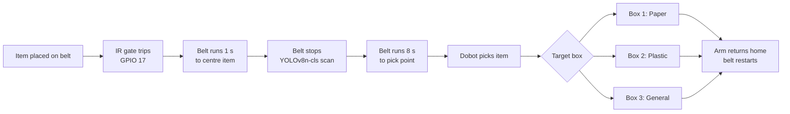

# EcoNexus — Robotic Waste-Sorting Line

A 1:20-scale automated waste-sorting line: a conveyor carries an item under a camera, a Raspberry Pi 4 classifies it on-device with YOLOv8, and a Dobot Magician arm picks it off the belt and drops it into a **Paper**, **Plastic** or **General** box. A small Flask page streams the live camera view with the line's status overlaid.

Built by a BEng (Hons) Robotics and Artificial Intelligence team (University of Hertfordshire, delivered at PSB Academy, Singapore) as the sorting cell of a smart waste management competition project.

> **Status:** the prototype was built and demonstrated, then dismantled. This repository holds the control script for the line, now with the paper's confidence gate, and a notebook that evaluates the gate offline on TrashNet. The gate has not yet been tested on the physical line.

---

## How the line works



One cycle, step by step:

1. The conveyor runs continuously at 25 mm/s.
2. An item breaks the IR beam; the belt runs one more second so the item sits under the camera.
3. The belt stops. The centre half of the frame is cropped and passed to YOLOv8n-cls.
4. The belt runs 8 seconds to carry the item to the arm's pick point, then stops.
5. The Dobot lowers, grips, lifts to a safe hover height, moves over the target box and releases.
6. The arm returns home and the belt restarts for the next item.

Three threads run side by side: a camera worker (capture + overlay + JPEG encode), the sorting logic, and the Flask server.

## Hardware

| Part | Detail |
|---|---|
| Compute | Raspberry Pi 4 |
| Camera | CSI Camera Module V2 in a fixed 3D-printed mount |
| Manipulator | Dobot Magician with gripper, USB serial (`/dev/ttyACM0`) |
| Conveyor | Stepper-driven belt on the Dobot's Stepper 1 port |
| Trigger | IR sensor on Raspberry Pi GPIO 17 |
| Classifier | YOLOv8n-cls (Ultralytics), CPU inference on the Pi |
| Supply | 12 V DC, no mains exposure |

## Setup

On Raspberry Pi OS (64-bit):

```bash
sudo apt update
sudo apt install -y python3-picamera2

git clone https://github.com/kris072008/econexus.git
cd econexus
python3 -m venv --system-site-packages .venv
source .venv/bin/activate
pip install -r requirements.txt
```

`--system-site-packages` lets the virtual environment see the apt-installed `picamera2`. The `yolov8n-cls.pt` weights download automatically on first run.

## Run

```bash
python3 sorting_line.py
```

Then open `http://<pi-ip-address>:8000` on any device on the same network to watch the live feed. Stop with `Ctrl+C`; the script stops the belt and releases the arm and camera on exit.

## Configuration

Everything is set by constants at the top of `sorting_line.py`. Arm coordinates are specific to our bench layout and **must be re-taught** for any other setup.

| Constant | Default | Meaning |
|---|---|---|
| `DOBOT_PORT` | `/dev/ttyACM0` | Serial port of the Dobot |
| `CONVEYOR_SPEED` | `25.0` | Belt speed in mm/s |
| `SETTLE_TIME_SEC` | `1.0` | Belt run time after the IR trigger, to centre the item under the camera |
| `TRAVEL_TIME_SEC` | `8.0` | Belt run time from the camera to the pick point |
| `HOME_POS`, `PICK_POS` | — | Arm home and belt pickup poses (X, Y, Z, R) |
| `BOX_PAPER`, `BOX_PLASTIC`, `BOX_GENERAL` | — | Drop poses for the three boxes |
| `HOVER_Z` | `110.0` | Safe travel height between moves |
| `ROUTING_MODE` | `"classifier"` | `"classifier"` routes by the model with the confidence gate; `"sequence"` is the original Paper → Plastic → General demo |
| `MODEL_PATH` | `yolov8n-cls.pt` | Classifier weights. A 3-class model (`general`, `paper`, `plastic`) is used directly; the stock ImageNet model falls back to keyword mapping |
| `TAU` | `0.90` | Gate threshold τ. Paper or plastic predictions with confidence below τ go to General |
| `TEMPERATURE` | `1.0` | Temperature T for calibrated confidence, softmax(log p / T) |
| `LOG_FILE` | `sorting_log.csv` | One row per item: true class, prediction, confidence, routed box, diverted flag, inference time, cycle time |

If a `gate_config.json` file (written by the evaluation notebook) sits next to the script, `MODEL_PATH`, `TAU` and `TEMPERATURE` are read from it.

**Labelled runs:** before placing each item, open `http://<pi-ip-address>:8000/label/paper` (or `plastic` / `general`). The true class is written to the log only; the routing logic never reads it.

## Routing: classifier with confidence gate

Each item is classified once under the camera, then routed:

1. YOLOv8n-cls gives a predicted class ĉ and confidence p (optionally temperature-scaled).
2. **If ĉ is Paper or Plastic and p < τ, the item goes to General.** Otherwise it goes to ĉ.
3. The decision, confidence and timing are written to `sorting_log.csv`.

What is and isn't established:

- **The gate is implemented but has not been tested on the physical line.** The prototype was dismantled before a labelled run.
- **Offline evaluation:** `notebooks/econexus_gate_evaluation.ipynb` fine-tunes YOLOv8n-cls on TrashNet and measures the gate there (see below). Results on TrashNet do not carry over automatically to the line's own camera and lighting.
- **One IR sensor, timed travel.** The IR sensor on GPIO 17 marks the scan point; a fixed 8-second belt run (25 mm/s) carries the item to the pick point, with no sensor confirming arrival.
- The original demo behaviour is kept as `ROUTING_MODE = "sequence"`.

## Offline evaluation notebook

[`notebooks/econexus_gate_evaluation.ipynb`](notebooks/econexus_gate_evaluation.ipynb) runs on free Google Colab (T4 GPU):

- downloads TrashNet and merges it into paper (paper + cardboard), plastic, and general (glass + metal + trash);
- makes stratified 70 / 15 / 15 splits, repeated over three seeds;
- fine-tunes YOLOv8n-cls and reports the confusion matrix and per-class precision, recall and F1;
- fits temperature scaling on the validation split only;
- compares ungated vs gated routing at several thresholds (admitted items, stream purity, contamination, contaminants intercepted, recyclables lost, expected cost);
- picks τ on validation for cost ratios k = 1, 3, 9 and reports it once on the held-out test split;
- saves every table and figure and exports `econexus_yolov8n_cls_best.pt` plus `gate_config.json` for the Pi.

## District simulation

[`simulation/district_sim.py`](simulation/district_sim.py) is a SimPy + OR-Tools model of a district of 12 communal hubs feeding one sorting station. The original simulation code was lost; this is a **new model**, rebuilt from the paper's description with two changes: the sorting station is rate-based (items per hour), and sorting outcomes use the rates measured offline on TrashNet.

```bash
pip install simpy ortools numpy pandas
python simulation/district_sim.py            # 10 seeds, about 3 minutes plus a capacity sweep
```

It writes `simulation/results/`: per-run results (`runs.csv`), summary tables (`table_collection.csv`, `table_sorting_policies.csv`, `table_capacity_sweep.csv`) and `run_info.json` with every parameter. Each run lasts 120 days; the first 30 are discarded as warm-up, and results are mean ± standard deviation over 10 seeds. All four collection strategies see the same generated waste in each seed.

**Collection strategies:** fixed 3×/week (Mon/Wed/Fri), fixed daily, naive fill-based (collect only hubs ≥ 60% full), and fill-based with co-collection (a hub ≥ 60% triggers a trip that also empties hubs ≥ 30%).

**Main results** (per 30 days, mean ± sd over 10 seeds):

| Strategy | Distance (km) | CO₂ (kg) | Overflow hub-days |
|---|---|---|---|
| Fixed 3×/week | 119.1 ± 0.0 | 320.4 ± 0.0 | 10.8 ± 3.3 |
| Fixed daily | 274.8 ± 0.0 | 739.4 ± 0.0 | 0.0 ± 0.0 |
| Fill-based, naive | 211.9 ± 3.5 | 570.1 ± 9.4 | 5.8 ± 1.8 |
| Fill-based, co-collection | 136.9 ± 4.8 | 368.4 ± 12.9 | 0.9 ± 0.7 |

Fill-based collection with co-collection nearly removes overflow compared with the 3×/week schedule, but drives about 15% further; it halves distance compared with daily collection. A station at 800 items/hour (offered load ρ ≈ 0.65) reaches a steady state; at 450 items/hour (ρ ≈ 1.16) the backlog grows without limit.

**Assumptions:** every parameter is listed in `PARAMS` at the top of the script with its source (NEA, SingStat, US EPA, Sousa et al. 2023, IPCC 2006) or marked `ASSUMED`. Sorting outcomes are inputs taken from the TrashNet evaluation, so the simulation scales them to district volumes but does not validate them.

## The idea behind it: confidence-gated routing

Recycling streams lose value mainly through contamination. One wrong item in a recycling load can down-grade the whole load, while a recyclable sent to general waste costs only that one item. The two kinds of sorting error do not cost the same, yet classifiers are usually tuned for plain top-1 accuracy, which treats them as equal.

The proposed policy, with predicted class ĉ and softmax confidence p:

> If ĉ is paper or plastic and p < τ, send the item to **general waste**. Otherwise send it to ĉ.

The point is not that a gated system classifies better, but that it **fails more cheaply**: when unsure, it declines to guess. Whether that pays off depends on whether wrong predictions really do sit at low confidence, which has to be measured. Modern networks are known to be overconfident, so calibration (for example temperature scaling) may be needed first.

The paper sets out the test protocol for the physical line: **at least 760 items** (about 300 paper, 145 plastic, 315 general), sized from the offline rates so that ungated contamination is estimated within ±2 percentage points and there are enough contaminants (~22) to estimate how many the gate intercepts. Ground truth is logged but never read by the routing logic, and each candidate threshold gets a table of items admitted, stream purity, contaminants caught and recyclables lost.

## Engineering findings from the build

These cost real bench time and are not obvious from component datasheets:

- **Read the IR sensor from the Pi, not the Dobot.** The Dobot controller's own I/O returned a constant false across repeated tests. Wiring the sensor to Raspberry Pi GPIO gave a small interface that could be tested on its own.
- **Mount the ultrasonic fill sensor on the bin rim, not the lid.** A lid-mounted sensor moves with the lid and corrupts every reading taken while the lid is moving.
- **Mount the lid servo outside the bin.** A servo body inside the bin sits in the ultrasonic cone and produces constant false "full" readings.
- **Fix the camera geometry.** A rigid printed mount means training images and live images share the same framing.
- **Classification over detection.** YOLOv8n-cls needs only folder-per-class images (no bounding boxes) and finishes on the Pi's CPU within the belt cycle. All inference stays on the device, so the line works without a network.

## The wider project

The sorting line is one part of a larger smart waste management concept:

- **Instrumented bins** — Arduino-controlled, with an ultrasonic fill sensor, servo lid and red/green status LEDs, working locally even if the link to the supervisor fails.
- **District simulation** — rebuilt in this repository (see below); the original model was lost.
- **Citizen engagement** — an Alpha Mini robot as the public-facing side of the competition entry.

## Roadmap

- [x] Route by the classifier's output instead of the fixed sequence
- [x] Add the confidence gate with a configurable threshold τ and temperature scaling
- [x] Log true class, predicted class, confidence, routed class and cycle time per item
- [x] Offline evaluation notebook on TrashNet
- [ ] Train YOLOv8n-cls on waste images captured under the line's own camera
- [x] Rebuilt district simulation with a rate-based sorting station
- [ ] Add a second IR sensor at the pick point in place of timed travel
- [ ] Run the labelled evaluation on the physical line

## Team

Krishna Mahajan, Ayyappan, Seenivasan and Gokulkanan — BEng (Hons) Robotics and Artificial Intelligence, University of Hertfordshire at PSB Academy, Singapore.
Project supervisor: Hanafi, Lab Engineer (Robotics and AI), PSB Academy.

Accompanying paper (draft, unpublished): *Confidence-Gated Edge Classification for Robotic Waste Sorting: Architecture, Prototype and Offline Evaluation.*

## References

1. Kaza, S., Yao, L., Bhada-Tata, P., Van Woerden, F. *What a Waste 2.0: A Global Snapshot of Solid Waste Management to 2050.* World Bank.
2. Thung, G., Yang, M. *Classification of Trash for Recyclability Status* (TrashNet).
3. Jocher, G. et al. *Ultralytics YOLOv8.*
4. Geifman, Y., El-Yaniv, R. *Selective Classification for Deep Neural Networks.* NeurIPS.
5. Guo, C., Pleiss, G., Sun, Y., Weinberger, K. *On Calibration of Modern Neural Networks.* ICML.
6. Google OR-Tools.
7. SimPy: discrete-event simulation for Python.
